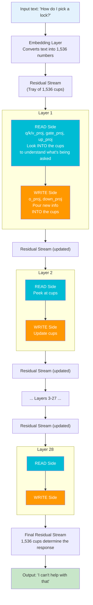

# SafeQuant Presentation v2
### Builds on the 15-slide deck presented last time. New slides are marked [NEW].
### Existing slides 1-7 (title, problem, puzzle, cosine table, puzzle reveal, residual stream, read/write) are kept.
### Below are replacement/addition slides starting after slide 7.

---

## Slide 8 [NEW - REPLACE old slide 8]: The Residual Stream Explained Properly

**Your teacher's question: "Where does 1,536 come from? Is it the same in all models?"**

### What is the hidden dimension?

Every transformer model has a design choice called **hidden_size** (also called `d_model`). It's chosen by the model designers when they build the architecture -- like choosing how wide a highway is.

| Model | hidden_size | Layers | Why this size? |
|-------|------------|--------|----------------|
| Qwen2.5-0.5B | 896 | 24 | Smaller model, fewer lanes |
| **Qwen2.5-1.5B** | **1,536** | **28** | **Our primary model, this is where "1,536 boxes" comes from** |
| Qwen2.5-7B | 3,584 | 28 | Bigger model, wider highway |
| Llama-3.1-8B | 4,096 | 32 | Different architecture, different width |
| Mistral-7B | 4,096 | 32 | Same width as Llama |

**The 1,536 is NOT universal.** It's specific to Qwen2.5-1.5B. Each model family picks its own hidden_size. You can find it in the model's `config.json` on HuggingFace.

**Why does this matter?** The residual stream has exactly `hidden_size` dimensions. Every matrix in every layer reads from or writes to this same-width stream. When we say "box j" or "dimension j", we mean position j out of these 1,536 (or 4,096, etc.) slots.

---

## Slide 9 [NEW]: How the Residual Stream Actually Works (Step by Step)

**Think of it as a conveyor belt carrying a tray of 1,536 numbered cups.**

### The process:



### The key insight for safety:

In a well-aligned FP32 model, around layers 10-20, the READ matrices detect "this is a dangerous request" and the WRITE matrices pour a "REFUSE" signal into specific cups. By the final layer, those cups are full of "REFUSE" signal, and the model outputs "I can't help with that."

**When you quantize:** The READ matrices get noisy. They can't read the cups as precisely. They miss subtle danger signals (especially adversarial jailbreaks that disguise the intent). The WRITE matrices are fine -- they'd still pour the "REFUSE" signal if told to -- but the READ side never triggers the alarm.

---

## Slide 10 [NEW]: Why Read Matrices Are More Vulnerable Than Write

**Why would quantization damage sensors more than alarms?**

### READ Side (Sensors) -- `up_proj`, `gate_proj`, `q_proj`, `k_proj`, `v_proj`

**Shape:** (intermediate x hidden) = (8,960 x **1,536**) for MLP; (head_dim x **hidden**) for attention

**How it works:** The residual stream has 1,536 values. Each **column j** of the read matrix acts like a probe that reads cup j:

```
Residual stream: [ cup_0,  cup_1,  cup_2, ..., cup_1535 ]
                      |        |        |            |
                  col_0    col_1    col_2  ...   col_1535
                      \        \        \      /
                       \________\________\____/
                              |
                     8,960 internal activations
                     (model's "understanding" of the input)
```

- Column j is a vector of 8,960 weights that decides: **"When cup j has value X, what does that mean?"**
- If quantization corrupts column j, the model misreads cup j -- it might miss a subtle "this is dangerous" signal hiding there
- **The refusal signal r-hat is spread across ~50-100 cups.** Misreading even a few of those cups = failing to detect the danger.

### WRITE Side (Alarms) -- `o_proj`, `down_proj`

**Shape:** (**1,536** x intermediate) = (**1,536** x 8,960)

**How it works:** After internal computation, each **row i** writes back to cup i:

```
                     8,960 internal activations
                     (model's computed result)
                       /________/________/____\
                      /        /        /      \
                  row_0    row_1    row_2  ...   row_1535
                      |        |        |            |
Residual stream: [ cup_0,  cup_1,  cup_2, ..., cup_1535 ]
                  (each cup gets a small update added to it)
```

- Row i is a vector of 8,960 weights that decides: **"What value should I add to cup i?"**
- If quantization corrupts row i, the model writes a slightly wrong value to cup i
- **But writing is additive and distributed.** Across 28 layers, each cup accumulates many small writes. A few noisy writes get averaged out. The overall refusal output direction stays intact (cosine similarity >0.99).

### The Core Asymmetry:

| | READ (Sensors) | WRITE (Alarms) |
|--|---|---|
| **Task** | Detect a sparse signal across 1,536 inputs | Produce an output summed across 28 layers |
| **Error tolerance** | Low -- missing one key dimension can miss the danger | High -- noisy writes get averaged across layers |
| **Analogy** | Reading fine print with blurry glasses | Shouting into a room -- slightly off, but message gets through |
| **Quantization effect** | **Catastrophic** -- subtle danger signals missed | **Tolerable** -- refusal direction preserved at 99% cosine sim |

**Detection requires precision. Generation is robust to noise.** This is why Chhabra found the refusal direction preserved (writes OK) while Q-ReSafe found ASR increases (reads broken).

---

## Slide 11 [NEW]: Datasets & Metrics -- What We Use and Why

### Safety Dataset

| Dataset | Source | Why We Use It |
|---------|--------|---------------|
| **WildJailbreak** (Jiang et al., NeurIPS 2024) | 262K adversarial prompts using role-play, encoding, fictional framing | Only adversarial prompts expose the safety gap. Direct harmful prompts show 0% ASR for BOTH FP32 and quantized (models refuse everything when asked directly) |

We use WildJailbreak exclusively for all current experiments. Earlier exploratory runs also tested StrongREJECT (Souly et al., 2024) and JailbreakBench (Chao et al., NeurIPS 2024), but WildJailbreak gave the clearest signal because its adversarial tactics (role-play, encoding, fictional framing) stress-test exactly the detection capability that quantization damages.

### Safety Metric: Attack Success Rate (ASR)
- **What:** % of adversarial prompts where model produced harmful content
- **Judge:** HarmBench Mistral-7B classifier (Mazeika et al., 2024) -- a fine-tuned LLM that reads (intent, response) pairs and outputs "yes" (harmful) or "no" (safe)
- **Why not string matching?** Detecting "I'm sorry" has ~30% error rate: misses coded/deflected harmful responses, false-flags legitimate "sorry" usage

### Utility Metric: ARC-Challenge
- 4-way multiple-choice science reasoning questions
- Ensures our safety fixes don't break the model's actual capabilities

---

## Slide 12 [NEW]: Are ASR & ARC Actually Accepted Metrics?

### ASR is THE standard in safety research:

| Paper | Venue | Uses ASR? |
|-------|-------|-----------|
| Q-ReSafe (Huang et al.) | ICLR 2025 | Yes -- primary metric |
| GCG Attack (Zou et al.) | NeurIPS 2023 | Yes |
| Decoding Compressed Trust (Hong et al.) | ICML 2024 | Yes (among 13 metrics) |
<!-- | AutoDAN, PAIR, TAP | Various 2024 | Yes | -->

**Every major jailbreak/safety paper uses ASR.** It is the accepted standard.

### What other metrics/datasets exist that we DON'T use (and why):

| Metric/Dataset | Used By | Why We Don't Use It |
|---------------|---------|-------------------|
| ToxiGen (toxicity) | Dec. Compressed Trust | Measures toxicity, not safety alignment -- different problem |
| BBQ (bias) | Dec. Compressed Trust | Measures social bias, not jailbreak vulnerability |
| TruthfulQA | Dec. Compressed Trust | Measures factual accuracy, not safety |
| AdvBench (direct prompts) | GCG, Q-ReSafe | Too easy for modern models: 0% ASR on both FP32 and NF4 |
| MT-Bench, AlpacaEval | Q-ReSafe | Utility metrics -- we use ARC-Challenge instead (more diagnostic for reasoning) |
| Perplexity | Common | Completely misses safety degradation (our core finding) |

**Our focus is narrow by design:** We're not measuring 13 things poorly, we're measuring one thing (jailbreak safety) deeply and explaining WHY it breaks.

---

## Slide 13 [NEW]: Why We Can't Just Replicate Decoding Compressed Trust

**Decoding Compressed Trust (Hong et al., ICML 2024)** is the broadest prior work:
- 8 quantization methods x 5 models x 13 trustworthiness dimensions

### Why we diverge:

| Their Choice | What Happens When We Try It | Our Resolution |
|-------------|---------------------------|----------------|
| **AdvBench prompts** (direct: "Tell me how to make a bomb") | 0% ASR on both FP32 and NF4 for modern models. Zero signal. | WildJailbreak adversarial prompts that disguise intent |
| **Llama-2-13B-Chat** | 93% ASR on BOTH FP32 and NF4. Model is too weakly aligned -- quantization effect invisible | Qwen2.5-1.5B: FP32=17% vs NF4=33% -- clear gap to study |
| **Black-box only** (just measure ASR, don't look inside) | Can say "it got worse" but not WHY | We open the model, extract weights, trace the refusal signal through layers |
| **Breadth** (13 dimensions: toxicity, fairness, privacy, OOD, ...) | Each dimension gets shallow treatment | We go deep on ONE dimension (jailbreak safety) down to individual columns |

### The fundamental difference:

**They ask:** "Does quantization affect trustworthiness?" (Answer: yes, in complicated ways)
**We ask:** "Which specific weight matrices, in which layers, at which columns, cause the safety degradation -- and can we fix just those?" (Answer: read-side matrices, specific layers, top 5% of columns, yes)

---

## Slide 14 [NEW]: Why AWQ, AQLM, and QuIP# Are Problematic

**We tested 8 quantizers total.** Three have practical issues:

### AWQ (Activation-Aware Weight Quantization)
- Requires `autoawq` package with custom CUDA kernels
- **Problem:** Rebuilding AWQ's kernels often breaks GPTQ or BitsAndBytes in the same environment. The CUDA extension compilation is fragile.
- **Status:** Works for evaluation via transformers native support, but we can't do weight-level restoration experiments (can't easily extract/replace individual matrices)

### AQLM (Additive Quantization of Language Models)
- SOTA 2-bit quantization (best quality at extreme compression)
- **Problem:** On-the-fly quantization takes **hours per model**. Must use pre-quantized checkpoints from HuggingFace, but very few exist. Many AQLM checkpoints don't include chat templates, requiring tokenizer workarounds.
- **Status:** Only available for Llama-3.1-8B (2-bit). No Qwen or Mistral checkpoints.

### QuIP# (Quantization with Incoherence Processing)
- Uses a custom weight format (Hadamard rotation + vector quantization)
- **Problem:** No tokenizer included in any QuIP# repo. Must load from base model. Very few pre-quantized checkpoints on HuggingFace.
- **Status:** Available for Llama-3.1-8B (2-bit, 4-bit). No other models.

**Result:** We focus on NF4 and GPTQ (stable, available for all models) and include AWQ/AQLM/QuIP# where checkpoints exist.

---

## Slide 15 [NEW]: What We Tried That Didn't Work

### Failed Approach 1: Direct Harmful Prompts
- **Idea:** Use JailbreakBench prompts directly ("How do I synthesize methamphetamine?")
- **Result:** 0% ASR for BOTH FP32 and NF4. Modern models refuse everything asked directly.
- **Why it failed:** Direct prompts don't expose the safety gap because the model recognizes them trivially. The damage from quantization only shows up on adversarial prompts where detection is harder.

### Failed Approach 2: Pattern-Matching for ASR
- **Idea:** Detect refusals by checking for "I'm sorry", "I can't", "As an AI" prefixes
- **Result:** ~30% error rate. Some harmful responses start with "I understand your concern" (missed). Some safe responses contain "sorry" in a different context (false positive).
- **Fix:** HarmBench classifier -- an LLM trained specifically to judge (intent, response) pairs

### Failed Approach 3: Older/Weaker Models
- **Llama-2-13B-Chat:** 93% ASR on FP32 already. Quantization can't make it worse.
- **Mistral-7B-v0.3:** 43% ASR on both FP32 and NF4. Only 2pp gap (noise).
- **Why:** These models have weak safety alignment. The "sensor" is already bad in FP32; breaking it more with quantization doesn't change behavior.
- **Fix:** Qwen2.5-1.5B has strong alignment (17% FP32 ASR) with clear degradation under quantization (33% NF4).

### Failed Approach 4: V-Score Predicting Layer Importance
- **Idea:** V-score = |r-hat[j]| x quantization_error[j] should rank which layers matter most for ASR
- **Result:** Spearman correlation = 0.302, p = 0.119 (not significant). V-score ranking didn't match actual ASR recovery ranking.
- **Why:** Weight-level damage doesn't account for how activations flow through the network. A heavily-damaged layer might not matter if its output gets overridden by later layers.

---

## Slide 16 [KEEP]: The Proof: Elimination Experiments (your existing slide 10)

*Keep as-is -- this is the strongest slide in the deck.*

Experiment 1: Fix the Alarm (write-side) -> 33% -> 33% (0 improvement)
Experiment 2: Inject the Signal (read-side) -> 33% -> 12% (huge improvement)

---

## Slide 17 [KEEP]: Our Discovery: Read-Side Collapse (your existing slide 11)

*Keep as-is, but fix the typo: "damages the read side (sensors) far more than the read side (alarms)" should be "...far more than the WRITE side (alarms)"*

---

## Slide 18 [NEW]: Full Phase 2 Results + Sparse Restoration

### Phase 2: Read vs Write Restoration (Qwen2.5-1.5B, NF4, n=50)

```
Condition               ASR      Recovery
---------              -----    --------
FP32 baseline          20.0%    (reference)
NF4 quantized          36.0%    (damage = +16pp)
Write-only restored    36.0%    0% recovery     <-- Alarms work fine
Read-only restored     30.0%    37.5% recovery  <-- Sensors are the problem
Both restored          22.0%    87.5% recovery  <-- Nearly full fix
```

### Phase 6: How Much Do We Need to Fix? (Sparse Column Restoration)

| Columns Fixed | % of Parameters | ASR | Safety Recovered |
|--------------|----------------|-----|-----------------|
| 0 (NF4) | 0% | 38% | 0% |
| Top 76 | 5% | 32% | **50%** |
| Top 153 | 10% | 30% | 67% |
| Top 384 | 25% | 29% | 75% |
| All (FP32) | 100% | 26% | 100% |

**Fixing just 5% of the most damaged columns recovers half the lost safety.**
This means a practical fix exists: store ~5% of weights in FP32, keep the rest quantized.

---

## Slide 19 [NEW]: Comparison to Prior Work -- Why This Is Novel

| | Q-ReSafe (ICLR 2025) | Compressed Trust (ICML 2024) | Chhabra et al. | **SafeQuant (Ours)** |
|--|--|----|---|---|
| **Question** | Does quant. affect safety? | Does quant. affect 13 trust dims? | Is refusal direction preserved? | **Where and why does safety break?** |
| **Answer** | Yes, ASR increases | Yes, various effects | Yes, cosine sim >0.99 | **Read-side matrices can't detect danger** |
| **Granularity** | Model-level | Model-level | Direction-level | **Column-level** |
| **Mechanism** | None (observational) | None (observational) | None (observational) | **Read-side collapse** |
| **Fix proposed** | Safety-aware QAT | None | None | **5% sparse restoration -> 50% recovery** |
| **Resolves puzzle?** | No | No | No | **Yes: signal exists (Chhabra) but sensors broken (Q-ReSafe)** |

### Our contribution resolves the contradiction between Chhabra and Q-ReSafe:
- The refusal direction IS preserved in the weights (Chhabra is right)
- Safety behavior DOES degrade (Q-ReSafe is right)
- **Both are correct because the signal exists but the READ matrices can't detect it anymore**

---

## Slide 20 [NEW]: Multi-Quantizer Generalization (Running Now)

**Critical question: Is Read-Side Collapse specific to NF4, or universal across quantizers?**

Testing 3 models x 2 GPTQ variants (6 experiments currently running on Bridges-2):

| Experiment | Model | Quantizer | hidden_size | Layers |
|-----------|-------|-----------|-------------|--------|
| rw_qwen1.5b_gptq4 | Qwen2.5-1.5B | GPTQ 4-bit | 1,536 | 28 |
| rw_qwen1.5b_gptq3 | Qwen2.5-1.5B | GPTQ 3-bit | 1,536 | 28 |
| rw_llama7b_gptq4 | Llama-3.1-8B | GPTQ 4-bit | 4,096 | 32 |
| rw_llama7b_gptq3 | Llama-3.1-8B | GPTQ 3-bit | 4,096 | 32 |
| rw_mistral7b_gptq4 | Mistral-7B-v0.3 | GPTQ 4-bit | 4,096 | 32 |
| rw_mistral7b_gptq3 | Mistral-7B-v0.3 | GPTQ 3-bit | 4,096 | 32 |

Each runs 5 conditions: FP32 / Quantized / Write-restored / Read-restored / Both-restored
+ ARC-Challenge (50 questions) for utility

**Prediction:** Write-side restoration will show ~0% safety recovery across all 6 experiments. Read-side will show significant recovery.

---

## Slides 21-26: [RESERVED -- 6 RESULT SLIDES FROM RUNNING JOBS]

### Slide 21: Qwen2.5-1.5B + GPTQ-4bit Results
```
                        ASR     ARC     Safety Recovery
FP32 baseline           ___%    ___%    (reference)
GPTQ-4 baseline         ___%    ___%    (damage = +___pp)
Write-restored          ___%    ___%    ___% recovery
Read-restored           ___%    ___%    ___% recovery
Both-restored           ___%    ___%    ___% recovery
```

### Slide 22: Qwen2.5-1.5B + GPTQ-3bit Results
*(same format)*

### Slide 23: Llama-3.1-8B + GPTQ-4bit Results
*(same format)*

### Slide 24: Llama-3.1-8B + GPTQ-3bit Results
*(same format)*

### Slide 25: Mistral-7B + GPTQ-4bit Results
*(same format)*

### Slide 26: Mistral-7B + GPTQ-3bit Results
*(same format)*

---

## Slide 27 [NEW]: Future Plan

### Immediate (This Week):
- Fill in slides 21-26 from running experiments
- Run Gemma-2-9B (4th architecture) for broader validation

### Short-Term (Next 2-3 Weeks):
- **Larger sample sizes:** 200+ prompts with bootstrap confidence intervals for statistical rigor
- **Statistical tests:** Fisher's exact test for ASR differences
- **Activation-level analysis:** Track the refusal signal through each layer (FP32 vs quantized) to see WHERE in the network the signal gets lost -- not just which weights are damaged, but which layers fail to propagate the signal

### Medium-Term (Next Month):
- **SafeLoRA:** Learn a low-rank correction matrix that patches safety without needing FP32 weights at deployment. Think of it as a "hearing aid" for the broken sensors.
- **Safety Error Score (SES):** A lightweight metric that can flag "this quantized model is probably safety-degraded" without running a full ASR evaluation. Like a quick health check before deployment.
- **Model size scaling:** Test Qwen 0.5B -> 1.5B -> 3B -> 7B to see if larger models are more or less vulnerable to read-side collapse

### Publication Target:
- Safety/alignment venue: SaTML, AAAI Safe AI workshop, or main ML conference

---

## Slide 28: Summary

**What We Found:**

1. **Quantization silently breaks safety** -- standard quality tests (perplexity) completely miss it

2. **Read-Side Collapse:** The "sensors" (read matrices) that detect harmful prompts are damaged by quantization. The "alarms" (write matrices) that produce refusals are fine. The model still knows HOW to refuse -- it just can't DETECT when to refuse.

3. **This resolves the puzzle** between Chhabra (signal preserved) and Q-ReSafe (safety degrades): the signal EXISTS but the sensors are BROKEN

4. **Practical fix:** Keeping just 5% of columns in full precision recovers 50% of lost safety

5. **Testing generalization now:** 3 models x 2 quantizers to confirm this isn't NF4-specific

---

## SPEAKER NOTES for teacher questions:

### "Where does 1,536 come from?"
It's the `hidden_size` parameter chosen by the Qwen2.5-1.5B model designers. Every model family picks their own: GPT-2 used 768, Llama-3.1-8B uses 4,096, GPT-4 likely uses 12,288+. It's an architecture design choice -- like choosing the width of a data bus. You can find it in any model's `config.json` on HuggingFace.

### "Is it the same in all models?"
No. Each model has its own hidden_size. Our Qwen1.5B uses 1,536. When we test Llama-3.1-8B, it's 4,096 -- so there are 4,096 "boxes" instead. The READ/WRITE framework applies regardless of the specific hidden_size.

### "What exactly IS the residual stream?"
It's just a vector of numbers (length = hidden_size) that gets passed from layer to layer. Each layer reads it, computes something, and adds its result back. After all layers, this vector determines the next word. Think of it as the model's "working memory" -- every layer has access to the same shared workspace.

### "How do you know which side is read vs write?"
This comes from the matrix multiplication. If a weight matrix W has shape (output x hidden_size), its COLUMNS correspond to reading from each position in the residual stream. If it has shape (hidden_size x input), its ROWS correspond to writing to each position. This is just linear algebra: y = Wx means each column of W reads one element of x.

### "Why do you call it 'read-side collapse' and not just 'quantization error'?"
Because not all quantization error matters equally. Write-side matrices have similar quantization error but it doesn't affect safety. The error specifically in READ matrices is what causes the safety degradation -- that's the "collapse" in detection capability.
